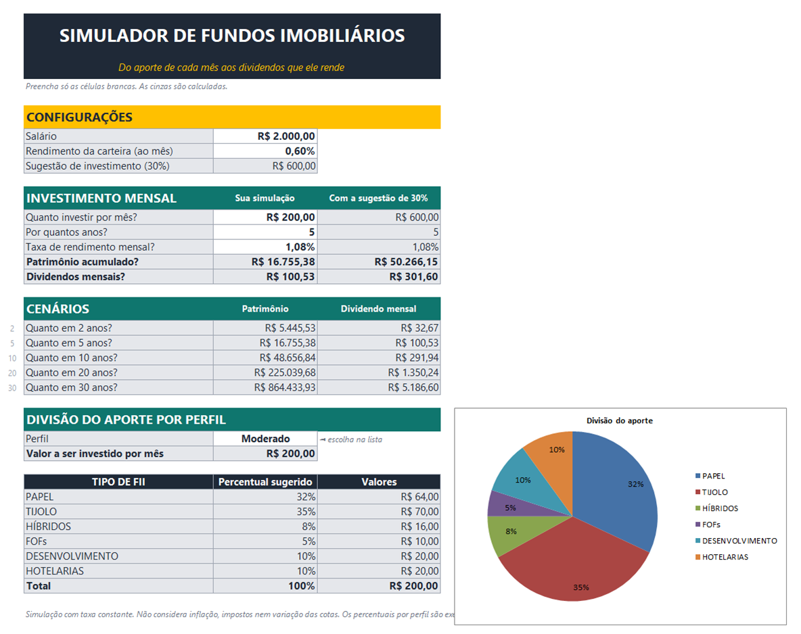
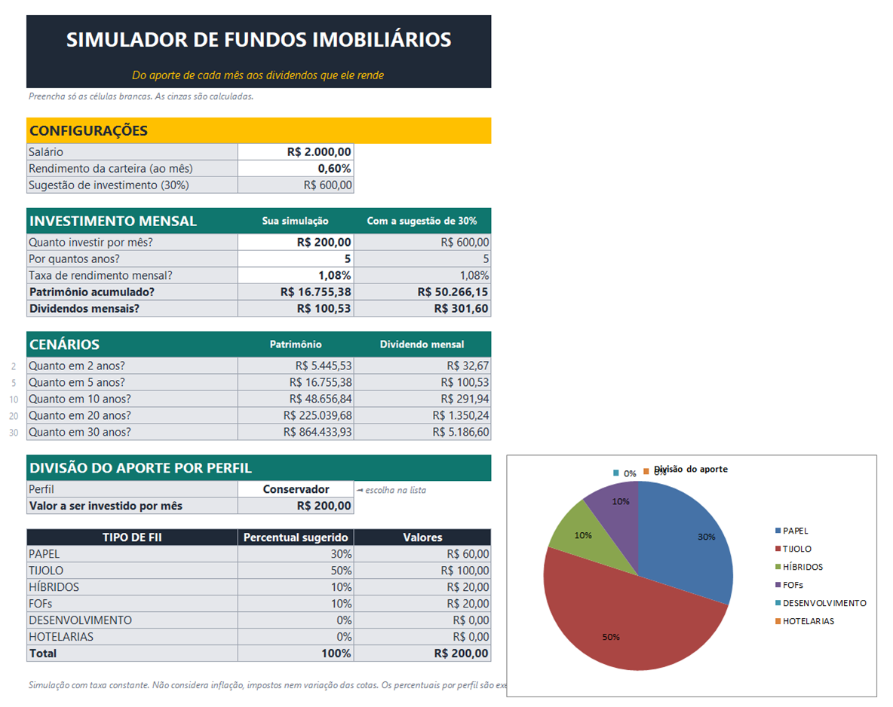
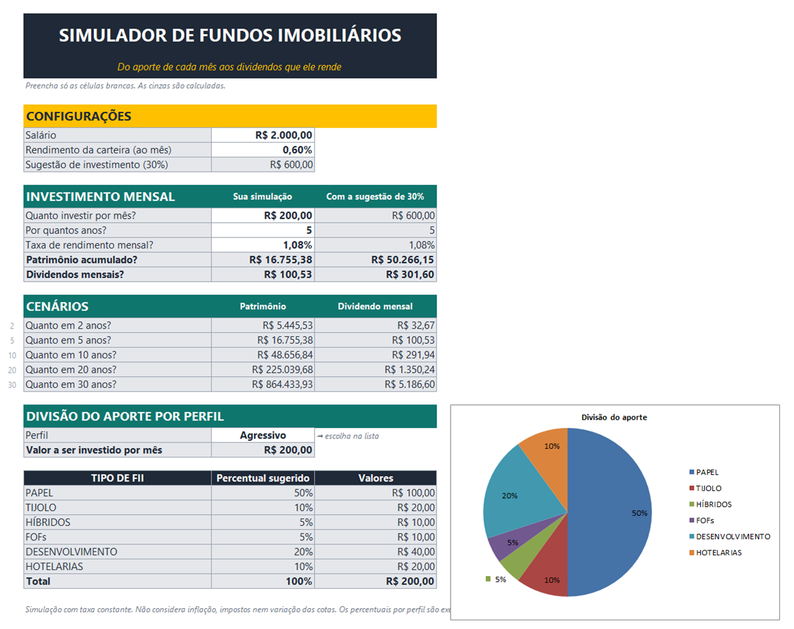

# Simulador de Fundos Imobiliários no Excel

Planilha que simula investimentos em fundos imobiliários (FIIs), do aporte de cada mês aos dividendos que ele rende. Projeto do desafio "Simulador de investimentos com Excel" da DIO, com o Expert Felipe Aguiar.

Arquivo: [`simulador-fii.xlsx`](simulador-fii.xlsx)



## Perguntas que a ferramenta responde

Tudo fica na aba `APP`. As células brancas são para preencher; as cinzas são calculadas.

| Pergunta | Onde aparece | Tipo |
|---|---|---|
| Quanto investir por mês? | `C13` | Você informa |
| Por quantos anos? | `C14` | Você informa |
| Qual a taxa de rendimento mensal? | `C15` | Você informa |
| Quanto de patrimônio vai acumular? | `C16` | Calculado com `VF` |
| Quanto vai receber de dividendos por mês? | `C17` | Calculado |

Além disso:

- **Cenários** (`C20:D24`): o mesmo cálculo para 2, 5, 10, 20 e 30 anos.
- **Divisão por perfil** (`C31:D37`): o aporte dividido entre seis tipos de FII, conforme o perfil escolhido na lista em `C27`.

## Como o VF e o PROCV entram nos cálculos

### VF (valor futuro)

```
=VF(taxa_mensal; qtd_anos*12; aporte*-1)
```

- `taxa_mensal`: quanto o dinheiro rende por período. Como o aporte é mensal, a taxa também é mensal.
- `qtd_anos*12`: número de períodos. O prazo é informado em anos, então é multiplicado por 12 para virar meses.
- `aporte*-1`: o pagamento de cada período. O Excel trata dinheiro que sai do bolso como negativo; multiplicar por -1 faz o resultado sair positivo.

Com R$ 200,00 por mês, 5 anos e 1,079% ao mês, o patrimônio acumulado é de R$ 16.755,38.

Os dividendos mensais são o patrimônio multiplicado pelo rendimento da carteira:

```
=patrimonio*rendimento_carteira
```

São duas taxas diferentes de propósito: `taxa_mensal` é o quanto o patrimônio cresce (dividendos reinvestidos mais valorização das cotas) e `rendimento_carteira` é só o que a carteira paga de dividendo por mês.

Nos cenários a fórmula é a mesma, trocando o prazo pelo número de anos da coluna A. O `$` na coluna trava a referência para a fórmula não se perder ao arrastar:

```
=VF(taxa_mensal; $A20*12; aporte*-1)
```

### PROCV com chave composta

O percentual de cada tipo de fundo depende de duas coisas: o perfil e o tipo. O `PROCV` só procura por um valor, então a aba `Apoio` tem uma coluna `CHAVE` que junta os dois:

```
=B3&"-"&C3        resultado: Moderado-TIJOLO
```

Na aba `APP`, a fórmula monta a mesma chave com o perfil escolhido e o tipo da linha, e busca o percentual na quarta coluna da tabela:

```
=PROCV(perfil&"-"&B31; tabela_perfis; 4; FALSO)
```

O `FALSO` pede correspondência exata. O valor de cada tipo é o percentual multiplicado pelo aporte (`=C31*$C$28`).

## Intervalos nomeados

| Nome | Refere-se a | O que é |
|---|---|---|
| `salario` | `APP!C8` | Salário mensal |
| `rendimento_carteira` | `APP!C9` | Dividendo mensal da carteira, em % |
| `sugestao_investimento` | `APP!C10` | 30% do salário |
| `aporte` | `APP!C13` | Valor investido por mês |
| `qtd_anos` | `APP!C14` | Prazo em anos |
| `taxa_mensal` | `APP!C15` | Taxa de rendimento mensal |
| `patrimonio` | `APP!C16` | Patrimônio acumulado |
| `perfil` | `APP!C27` | Perfil escolhido na lista |
| `tabela_perfis` | `Apoio!A3:D20` | Tabela de chave, perfil, tipo e percentual |
| `lista_perfis` | `Apoio!F3:F5` | Perfis que alimentam a validação de dados |

## Percentuais de cada perfil

| Tipo de FII | Conservador | Moderado | Agressivo |
|---|---:|---:|---:|
| Papel | 30% | 32% | 50% |
| Tijolo | 50% | 35% | 10% |
| Híbridos | 10% | 8% | 5% |
| FOFs | 10% | 5% | 5% |
| Desenvolvimento | 0% | 10% | 20% |
| Hotelarias | 0% | 10% | 10% |
| **Total** | **100%** | **100%** | **100%** |

São os percentuais de exemplo que o Expert usa nas aulas. Não são recomendação de investimento. Para usar outros, edite a coluna `%` da aba `Apoio`; a conferência ao lado mostra se cada perfil soma 100%.

O salário (R$ 2.000,00), o aporte (R$ 200,00) e as taxas também são os valores de exemplo das aulas, não dados reais.

## O que mudei em relação à ferramenta do Expert

- **Segunda simulação com a sugestão de 30%**: uma coluna ao lado mostra patrimônio e dividendos caso o aporte fosse 30% do salário.
- **Gráfico de pizza** da divisão do aporte, que muda junto com o perfil.
- **Total da coluna de percentuais** e **conferência de 100% por perfil** na aba de apoio, com `SOMASE`.
- **Mais intervalos nomeados**: `perfil`, `tabela_perfis` e `lista_perfis`. O `PROCV` e os cenários usam nomes no lugar de endereços como `$D$19`.
- **Lista de perfis vinda da aba de apoio**, em vez de digitada dentro da validação de dados.
- **Rótulos dos cenários por fórmula** (`="Quanto em "&$A20&" anos?"`): mudar o número de anos na coluna A atualiza o texto.
- **Banner feito com células formatadas**, sem imagem, e títulos de linha e coluna ocultos na aba `APP`.

## Evidências

A mesma simulação (R$ 200,00 por mês, 5 anos, 1,079% ao mês) em perfis diferentes. O patrimônio e os dividendos não mudam; só a divisão do aporte.

### Perfil Conservador



### Perfil Agressivo



Os resultados batem com a planilha resolvida do Expert usando os mesmos valores de entrada: patrimônio de R$ 16.755,38 em 5 anos e R$ 864.433,93 em 30 anos.

## Limites da simulação

A taxa é constante durante todo o período. A planilha não considera inflação, impostos nem variação no preço das cotas. Serve para estudo e planejamento, não como previsão.
